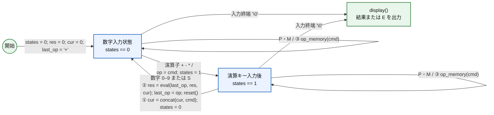
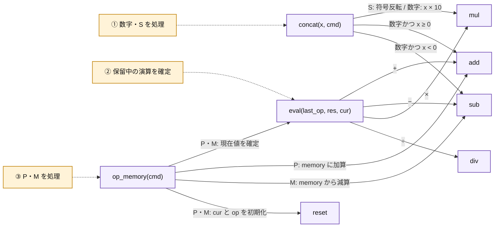

# `calc0.c` の状態遷移と関数呼び出し

この図は [`calc0.c`](calc0.c) の現行実装を表す。矢印のラベルは「入力 / 主な動作」。丸数字は下の関数呼び出し図と対応する。

`=` は `res` を更新するが、そこで表示はしない。`display()` は入力文字列の終端で一度だけ呼ばれる。`P`・`M` は `op_memory()` 内で `eval()` の結果を `memory` に加減算し、`cur` と `op` を初期化する。`R`・`C` と入力分類用の `is_*` 関数は図から省略した。
